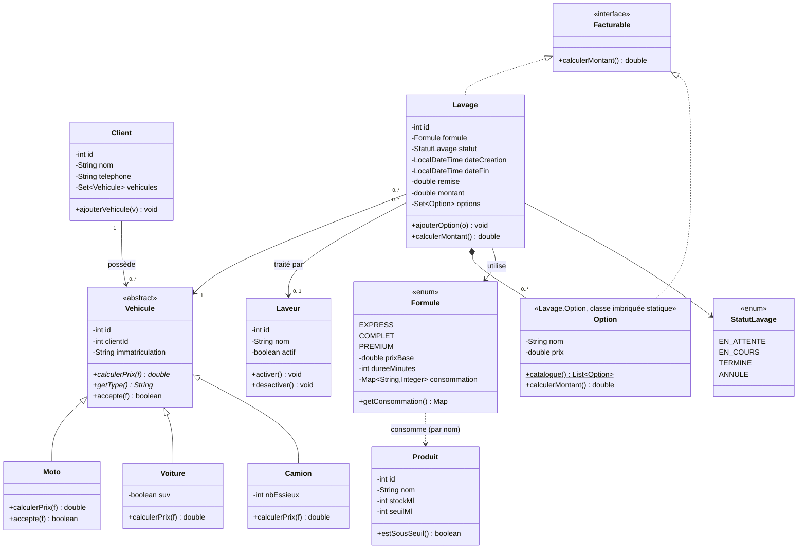

# Station de lavage auto

Projet de Java avancé : une application Java 21 qui gère une station de lavage, d'abord en console (phase 1), puis avec une interface JavaFX (phase 2).

## 1. Sujet

Le gérant d'une station de lavage suit tout sur papier : il perd l'historique des clients, découvre trop tard les ruptures de produits et ne connaît pas son chiffre d'affaires réel. L'application lui permet de :

- enregistrer et suivre chaque lavage, de l'arrivée du véhicule à la fin du service ;
- calculer automatiquement le prix selon le véhicule, la formule et les options ;
- contrôler le stock de produits et signaler les seuils bas ;
- consulter des recherches et des statistiques sur l'activité ;
- conserver les données dans une base H2 et exporter les résultats dans des fichiers ;
- simuler plusieurs laveurs qui travaillent en même temps sur une file d'attente et un stock communs.

L'application a un seul utilisateur, le gérant, sur un poste local.

### Fonctions

| Réf. | Fonction | Où la trouver |
|------|----------|---------------|
| F1 | Gérer les clients (ajouter, modifier, supprimer, consulter) | Console 1, écran « Clients et véhicules » |
| F2 | Gérer les véhicules, rattachés à un client | Console 2, écran « Clients et véhicules » |
| F3 | Gérer les laveurs, avec activation et désactivation | Console 3 |
| F4 | Gérer les produits et réapprovisionner le stock | Console 4 |
| F5 | Enregistrer un lavage (véhicule, formule, options, montant) | Console 5, écran « Lavages » |
| F6 | Suivre un lavage (attribuer un laveur, démarrer, terminer, annuler) | Console 6, écran « Lavages » |
| F7 | Rechercher (client par nom ou téléphone, véhicule par immatriculation, lavages par date, statut ou laveur) | Console 7, recherche de clients à l'écran |
| F8 | Statistiques | Console 8, écran « Tableau de bord » |
| F9 | Lancer la simulation et afficher le bilan | Console 9, écran « Tableau de bord » |
| F10 | Exporter (CSV, ticket .txt, journal) | Console 10, bouton « Ticket » de l'écran « Lavages » |

### Règles métier

*Montant = (prix du véhicule + somme des options) × (1 − remise)*

| Formule | Prix de base | Durée simulée | Consommation |
|---------|--------------|---------------|--------------|
| EXPRESS | 30 MAD | 15 min | 200 ml de shampooing |
| COMPLET | 50 MAD | 30 min | 300 ml de shampooing |
| PREMIUM | 80 MAD | 45 min | 300 ml de shampooing, 100 ml de cire |

| Véhicule | Prix | Formules acceptées | Exemple |
|----------|------|--------------------|---------|
| Moto | base × 0,7 | Express seulement | Express : 21 MAD |
| Voiture | base, + 10 MAD si SUV | Toutes | Premium SUV : 90 MAD |
| Camion | base × 1,5, + 10 MAD par essieu au-delà de 2 | Toutes | Complet, 3 essieux : 85 MAD |

- **Options :** désodorisant (10 MAD), cirage des pneus (15 MAD), nettoyage moteur (40 MAD), une seule fois chacune par lavage.
- **Fidélité :** 10 % de remise pour un client qui a au moins 10 lavages terminés.
- **Statuts :** EN_ATTENTE → EN_COURS → TERMINE. Un lavage peut passer à ANNULE tant qu'il n'a pas commencé.
- **Stock :** les produits sont retirés au démarrage. Si le stock est insuffisant, le lavage est annulé et le stock ne change pas.
- **Laveurs :** un laveur doit être actif, et il ne traite qu'un lavage à la fois.
- **Suppression :** un client, un véhicule ou un laveur qui a des lavages n'est pas supprimé. Un laveur qui part est désactivé.

### Choix faits là où le cahier des charges n'était pas précis

- Le chiffre d'affaires et le panier moyen ne comptent que les lavages **TERMINE**. La « formule la plus demandée » compte tous les lavages créés.
- On peut attribuer un laveur occupé à un lavage en attente, mais le **démarrage** est refusé tant qu'il a déjà un lavage EN_COURS.
- Un client sans lavage est supprimé avec ses véhicules (`ON DELETE CASCADE`).
- Les règles non respectées lèvent `IllegalStateException`, les saisies invalides `IllegalArgumentException`, et les erreurs SQL sont enveloppées dans `BaseDonneesException`.
- La simulation utilise des laveurs « Laveur sim 1…N » et une voiture « SIM-0001 », qu'elle crée la première fois. Les formules tournent dans l'ordre Express, Complet, Premium, et une minute simulée dure 10 ms.

## 2. Diagramme de classes



### Architecture en paquets (`src/main/java/station`)

| Paquet | Rôle | Classes |
|--------|------|---------|
| `model` | Entités et énumérations | Facturable, Vehicule, Moto, Voiture, Camion, Client, Laveur, Produit, Lavage (+ Lavage.Option), Formule, StatutLavage |
| `exception` | Erreurs métier | StockInsuffisantException, FormuleNonDisponibleException, EntiteIntrouvableException |
| `dao` | Accès à H2 par JDBC | Connexion, Dao\<T\>, ClientDao, VehiculeDao, LaveurDao, ProduitDao, LavageDao, BaseDonneesException |
| `io` | Exports et journal | ExportService, Journal |
| `service` | Règles, recherches et statistiques | ClientService, VehiculeService, LaveurService, StockService, LavageService, RechercheService, StatistiqueService, Verification, Services |
| `simulation` | Laveurs en parallèle | SimulationService, TacheLaveur, BilanSimulation |
| `console` | Menu texte (phase 1) | MenuConsole, MenuGestion, MenuLavages, MenuRapports, Saisie |
| `ui` | Écrans JavaFX (phase 2) | ApplicationFx, ClientsController, LavagesController, TableauBordController, OutilsFx |

Les paquets `model`, `exception`, `dao`, `io`, `service` et `simulation` n'importent jamais `console` ni `ui`. La console et JavaFX utilisent les mêmes services, créés une seule fois par la classe `Services`. Passer à JavaFX n'a donc demandé aucune réécriture de la logique.

## 3. Lancer l'application

**Prérequis :** Java 21 et Maven 3.9 ou plus récent. Maven télécharge lui-même le pilote H2 et JavaFX.

Toutes les commandes se lancent **depuis la racine du projet**, car les chemins `sql/`, `data/`, `exports/` et `logs/` sont relatifs.

```bash
mvn compile                 # compiler
mvn compile exec:java       # version console (menu F1 à F10)
mvn compile javafx:run      # version JavaFX (trois onglets)
```

### Base de données

- La base H2 est un fichier : `data/station.mv.db`, avec l'URL `jdbc:h2:./data/station`, l'utilisateur `sa` et un mot de passe vide.
- Au démarrage, `Connexion.initialiserBase()` exécute le script [`sql/creation_base.sql`](sql/creation_base.sql). Il crée les six tables `client`, `vehicule`, `laveur`, `produit`, `lavage` et `lavage_option`, puis ajoute les deux produits de départ (shampooing et cire). Le script utilise `IF NOT EXISTS` : on peut le relancer sans perdre de données.
- Pour repartir de zéro, il suffit de supprimer le dossier `data/`.

### Fichiers produits

| Fichier | Contenu | Produit par |
|---------|---------|-------------|
| `exports/lavages.csv` | Une ligne par lavage : date, immatriculation, formule, laveur, statut, montant | `ExportService.exporterLavagesCsv()` |
| `exports/tickets/ticket-<id>.txt` | Détail d'un lavage et montant payé | `ExportService.genererTicket()` |
| `logs/journal.log` | Date, type d'opération et détail de chaque action | `Journal.ecrire()` |

## 4. Simulation multi-threads

1. `SimulationService.lancer()` prépare les laveurs, crée les lavages avec `LavageService.creer()` et remplit une `LinkedBlockingQueue<Lavage>`.
2. Un `ExecutorService` (`Executors.newFixedThreadPool(N)`) exécute une `TacheLaveur` par laveur.
3. Chaque `TacheLaveur.run()` prend un lavage avec `poll()`, retire les produits avec `StockService.consommer()`, attend avec `Thread.sleep()`, puis enregistre le résultat avec `LavageDao` et `Journal.ecrire()`.
4. Quand `poll()` renvoie `null`, la file est vide et la tâche s'arrête. `shutdown()` puis `awaitTermination()` attendent la fin de toutes les tâches.
5. `BilanSimulation` vérifie que terminés + annulés = créés, que chaque lavage est sorti une seule fois de la file, que stock final = stock initial − consommation des lavages terminés, et qu'aucun stock n'est négatif.

| Risque | Protection |
|--------|------------|
| Deux laveurs prennent le même lavage | `BlockingQueue.poll()` remet chaque élément à un seul thread |
| Le stock devient négatif | `StockService.consommer()` est `synchronized` : vérification, retrait et mise à jour en base forment un seul bloc. Une seule instance de `StockService` existe. |
| Une connexion JDBC partagée entre threads | Chaque méthode du DAO ouvre sa propre `Connection` dans un try-with-resources |
| Les lignes du journal se mélangent | `Journal.ecrire()` est `static synchronized` |
| La fenêtre JavaFX se bloque | La simulation tourne dans un autre `Thread`, et le bilan est affiché avec `Platform.runLater()` |

**Essai réalisé :** 5 simulations de suite avec 4 laveurs et 30 lavages sur une base neuve. Les 5 bilans sont justes. Le stock s'est épuisé pendant la 3e simulation (15 terminés, 15 annulés, 100 ml de shampooing restants), et les 4e et 5e simulations ont tout annulé sans toucher au stock. En base, les 150 lavages sont TERMINE ou ANNULE, et le journal contient une seule ligne de fin par lavage.

## 5. Exigences techniques

| Notion | Utilisation | Classe et méthode |
|--------|-------------|-------------------|
| POO : héritage, classe abstraite, interface, polymorphisme | Trois types de véhicules calculent leur prix différemment ; une interface unifie le calcul des montants | `Vehicule.calculerPrix()` (abstraite), redéfinie dans `Moto.calculerPrix()`, `Voiture.calculerPrix()`, `Camion.calculerPrix()` ; `Moto.accepte()` redéfinit `Vehicule.accepte()` ; `Facturable.calculerMontant()` implémentée par `Lavage` et `Lavage.Option` ; appel polymorphe dans `Lavage.calculerMontant()` |
| Collections : List | Listes ordonnées de résultats | `LavageService.lister()`, `Dao.lister()`, `RechercheService.lavagesParStatut()` |
| Collections : Set | Véhicules d'un client et options d'un lavage, sans doublon (`equals`/`hashCode` redéfinis) | `Client.ajouterVehicule()`, `Lavage.ajouterOption()`, `MenuLavages.choisirOptions()` |
| Collections : Map | Consommation de produits par formule, statistiques groupées | `Formule.getConsommation()`, `StockService.stockParNom()`, `StatistiqueService.caParFormule()` |
| Génériques | Interface commune à tous les DAO | `Dao<T>` : `ajouter()`, `trouverParId()` (retourne `Optional<T>`), `lister()`, `modifier()`, `supprimer()`, implémentée par `ClientDao`, `VehiculeDao`, `LaveurDao`, `ProduitDao`, `LavageDao` |
| Classes imbriquées | Une option n'existe qu'à l'intérieur d'un lavage ; une action de bouton qui peut lever une exception | `Lavage.Option` (classe imbriquée statique) ; `OutilsFx.Action` (interface imbriquée) |
| Lambdas et Streams | Toutes les recherches et statistiques, sans boucle | `RechercheService.clientsParNom()`, `.lavagesParStatut()`, `.lavagesParDate()`… ; `StatistiqueService.caParTypeVehicule()` et `.caParFormule()` avec `groupingBy` + `summingDouble`, `.lavagesParLaveur()` avec `counting()`, `.meilleurLaveur()` avec `max`, `.panierMoyen()` avec `average()` ; `StockService.consommer()` ; `SimulationService.consommation()` avec `flatMap` + `summingInt` |
| Entrées / sorties (java.nio) | Export CSV, ticket et journal | `ExportService.exporterLavagesCsv()`, `ExportService.genererTicket()`, `Journal.ecrire()`, `Journal.lire()` |
| JDBC | Persistance dans H2 par une couche DAO, avec `PreparedStatement` et try-with-resources | `Connexion.ouvrir()`, `Connexion.initialiserBase()`, `ClientDao`, `VehiculeDao`, `LaveurDao`, `ProduitDao`, `LavageDao` (dont `LavageDao.ajouter()` qui enregistre aussi les options) |
| Exceptions | Erreurs métier vérifiées | `StockInsuffisantException` levée par `StockService.consommer()`, `FormuleNonDisponibleException` levée par `LavageService.creer()`, `EntiteIntrouvableException` levée par les méthodes `trouver()` des services |
| Threads et concurrence | Plusieurs laveurs partagent la file, le stock et le journal | `SimulationService.lancer()` et `.executer()` (`ExecutorService`), `TacheLaveur.run()` (`BlockingQueue.poll()`), `StockService.consommer()` (`synchronized`), `Journal.ecrire()` (`synchronized`) |
| JavaFX | Trois écrans reliés aux services existants, sans copier de règle métier ; simulation hors du thread JavaFX | `ClientsController`, `LavagesController`, `TableauBordController` ; `TableauBordController.lancerSimulation()` et `.simulerHorsInterface()` avec `Platform.runLater()` |
