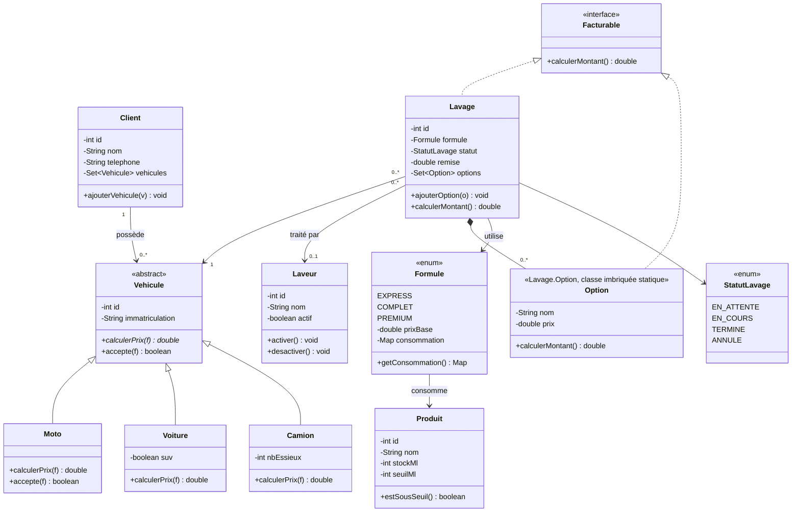

# Cahier des charges — Station de lavage auto

4 novembre 2026

# Présentation du projet

L’application gère une station de lavage auto : clients, véhicules, laveurs, produits et lavages. Elle simule aussi plusieurs laveurs qui travaillent en même temps sur une file d’attente et un stock communs.

Dans ce scénario, le gérant suit tout sur papier : il perd l’historique des clients, découvre trop tard les ruptures de produits et ne connaît pas son chiffre d’affaires réel.

L’application doit lui permettre de :

- enregistrer et suivre chaque lavage, de l’arrivée du véhicule à la fin du service ;

- calculer automatiquement le prix selon le véhicule, la formule et les options ;

- contrôler le stock de produits et signaler les seuils bas ;

- consulter les recherches et statistiques de l’activité ;

- conserver les données en base et exporter les résultats dans des fichiers.

# Périmètre

L’application est utilisée par un seul profil, le gérant de la station, sur un poste local.

| **Inclus**                                          | **Exclu**                             |
|-----------------------------------------------------|---------------------------------------|
| Gestion des clients, véhicules, laveurs et produits | Paiement en ligne                     |
| Enregistrement et suivi des lavages                 | Prise de rendez-vous en ligne         |
| Recherches, statistiques et exports                 | Gestion de plusieurs stations         |
| Simulation de laveurs en parallèle                  | Comptes utilisateurs et mots de passe |

# Besoins fonctionnels

Dix fonctions couvrent le sujet, et toutes fonctionnent déjà en console.

| **Réf.** | **Fonction**              | **Détail**                                                                                                                                                              |
|----------|---------------------------|-------------------------------------------------------------------------------------------------------------------------------------------------------------------------|
| F1       | Gérer les clients         | Ajouter, modifier, supprimer, consulter                                                                                                                                 |
| F2       | Gérer les véhicules       | Mêmes opérations, chaque véhicule étant rattaché à un client                                                                                                            |
| F3       | Gérer les laveurs         | Mêmes opérations, avec activation ou désactivation                                                                                                                      |
| F4       | Gérer les produits        | Mêmes opérations, plus réapprovisionnement du stock                                                                                                                     |
| F5       | Enregistrer un lavage     | Choisir le véhicule, la formule et les options, puis calculer le montant                                                                                                |
| F6       | Suivre un lavage          | Attribuer un laveur, démarrer, terminer ou annuler                                                                                                                      |
| F7       | Rechercher                | Client par nom ou téléphone, véhicule par immatriculation, lavages par date, statut ou laveur                                                                           |
| F8       | Produire des statistiques | Chiffre d’affaires total, par type de véhicule et par formule ; lavages par laveur ; meilleur laveur ; formule la plus demandée ; panier moyen ; produits sous le seuil |
| F9       | Lancer la simulation      | Choisir le nombre de laveurs et de lavages, puis afficher le bilan                                                                                                      |
| F10      | Exporter                  | Lavages en CSV, ticket en .txt, journal des opérations                                                                                                                  |

# Règles métier

Le montant d’un lavage dépend du véhicule, de la formule, des options et de la remise de fidélité. Les prix ci-dessous, en dirhams (MAD), sont des valeurs de départ que le groupe peut ajuster.

*Montant = (prix du véhicule + somme des options) × (1 − remise)*

| **Formule** | **Contenu**            | **Prix de base (MAD)** | **Durée simulée** | **Consommation**                     |
|-------------|------------------------|------------------------|-------------------|--------------------------------------|
| Express     | Extérieur              | 30                     | 15 min            | 200 ml de shampooing                 |
| Complet     | Extérieur et intérieur | 50                     | 30 min            | 300 ml de shampooing                 |
| Premium     | Complet et cire        | 80                     | 45 min            | 300 ml de shampooing, 100 ml de cire |

| **Véhicule** | **Calcul du prix**                                   | **Formules acceptées** | **Exemple**                 |
|--------------|------------------------------------------------------|------------------------|-----------------------------|
| Moto         | Prix de base × 0,7                                   | Express uniquement     | Express : 21 MAD            |
| Voiture      | Prix de base, + 10 MAD si SUV                        | Toutes                 | Premium, SUV : 90 MAD       |
| Camion       | Prix de base × 1,5, + 10 MAD par essieu au-delà de 2 | Toutes                 | Complet, 3 essieux : 85 MAD |

- **Options :** désodorisant (10 MAD), cirage des pneus (15 MAD), nettoyage moteur (40 MAD). Une même option ne peut être choisie qu’une fois par lavage.

- **Fidélité :** un client ayant au moins 10 lavages terminés obtient 10 % de remise sur chaque nouveau lavage.

- **Statuts :** un lavage passe de EN_ATTENTE à EN_COURS, puis à TERMINE. Il peut passer à ANNULE tant qu’il n’est pas commencé.

- **Stock :** le produit est retiré au démarrage du lavage. Si le stock est insuffisant, le lavage est annulé et le stock reste inchangé.

- **Laveurs :** un laveur actif traite un seul lavage à la fois, et un lavage n’a qu’un seul laveur.

- **Suppression :** un client, un véhicule ou un laveur lié à des lavages n’est pas supprimé, afin de garder l’historique. Un laveur qui quitte la station est désactivé.

# Conception

Le modèle compte cinq entités métier, et Lavage relie les autres. Vehicule porte la hiérarchie demandée, avec trois sous-classes.

Diagramme de classes (Figure 1), en texte :

Chaque sous-classe redéfinit calculerPrix(). Lavage additionne ensuite ce prix et les montants de ses options, puis applique la remise. La clé de Map dans Formule est le nom du produit, et sa valeur la quantité en millilitres.

Le code est séparé en paquets pour que la logique ne dépende jamais de l’interface :

| **Paquet** | **Rôle**                           | **Contenu principal**                                                                |
|------------|------------------------------------|--------------------------------------------------------------------------------------|
| model      | Entités et énumérations            | Client, Vehicule, Laveur, Produit, Lavage, Formule                                   |
| exception  | Erreurs métier                     | StockInsuffisantException, FormuleNonDisponibleException, EntiteIntrouvableException |
| dao        | Accès à H2                         | Dao\<T\> et ses implémentations                                                      |
| service    | Règles, recherches et statistiques | LavageService, StockService, RechercheService, StatistiqueService                    |
| simulation | Laveurs en parallèle               | SimulationService, TacheLaveur                                                       |
| io         | Exports et journal                 | ExportService, Journal                                                               |
| console    | Menu de la phase 1                 | MenuConsole                                                                          |
| ui         | Écrans de la phase 2               | Contrôleurs et vues JavaFX                                                           |

console et ui appellent seulement service et simulation. Ainsi, passer à JavaFX n’oblige pas à réécrire la logique.

# Simulation multi-threads

La simulation lance N laveurs sur une file et un stock partagés. Son bilan final prouve qu’aucun lavage n’est perdu ou traité deux fois, et que le stock reste juste.

Simulation (Figure 2), en texte :

- `SimulationService` crée les lavages, remplit la file d’attente (`BlockingQueue<Lavage>`) et lance un `ExecutorService` de N laveurs.
- Chaque `TacheLaveur` prend un lavage avec `poll()` (chaque lavage sort une seule fois) et traite un lavage à la fois.
- Chaque tâche consomme le stock via `StockService.consommer()` (`synchronized`), enregistre le statut et le montant avec `LavageDao` (une connexion par opération) et écrit dans `Journal.ecrire()` (`synchronized`).
- Ressources partagées entre les threads : la file d’attente, le stock et le journal.

1.  SimulationService.lancer() crée les lavages et remplit la file avant de démarrer les laveurs.

2.  Un ExecutorService exécute une TacheLaveur par laveur.

3.  Chaque tâche prend un lavage avec poll(), retire les produits et attend une durée simulée avec Thread.sleep().

4.  La tâche enregistre le résultat dans la base et le journal, puis reprend un lavage.

5.  Quand la file est vide, les tâches s’arrêtent et awaitTermination() attend la fin avant d’afficher le bilan.

| **Risque**                                    | **Protection**                                                                                                         |
|-----------------------------------------------|------------------------------------------------------------------------------------------------------------------------|
| Deux laveurs prennent le même lavage          | BlockingQueue remet chaque élément à un seul thread                                                                    |
| Le stock devient négatif                      | StockService.consommer() est synchronized : la vérification, le retrait et la mise à jour en base forment un seul bloc |
| Une connexion JDBC est partagée entre threads | Chaque opération du DAO ouvre sa propre Connection dans un try-with-resources                                          |
| Les lignes du journal se mélangent            | Journal.ecrire() est synchronized                                                                                      |

**Contrôles affichés dans le bilan :**

- lavages terminés + lavages annulés = lavages créés ;

- stock final = stock initial − consommation des lavages terminés ;

- aucun stock négatif.

# Données et fichiers

Les données sont stockées dans une base H2 via JDBC, avec des PreparedStatement et une couche DAO séparée de la logique. Le script sql/creation_base.sql crée les six tables. L’enseignant a accepté H2 à la place de MySQL ou PostgreSQL.

| **Table**     | **Colonnes principales**                                                              |
|---------------|---------------------------------------------------------------------------------------|
| client        | id, nom, telephone (unique)                                                           |
| vehicule      | id, client_id, immatriculation (unique), type, suv, nb_essieux                        |
| laveur        | id, nom, actif                                                                        |
| produit       | id, nom, stock_ml, seuil_ml                                                           |
| lavage        | id, vehicule_id, laveur_id, formule, statut, date_creation, date_fin, remise, montant |
| lavage_option | lavage_id, nom, prix                                                                  |

La colonne type permet au DAO de recréer le bon objet : Moto, Voiture ou Camion.

| **Fichier**                       | **Contenu**                                                                    | **Produit par**                    |
|-----------------------------------|--------------------------------------------------------------------------------|------------------------------------|
| exports/lavages.csv               | Une ligne par lavage : date, immatriculation, formule, laveur, statut, montant | ExportService.exporterLavagesCsv() |
| exports/tickets/ticket-\<id\>.txt | Détail d’un lavage et montant payé                                             | ExportService.genererTicket()      |
| logs/journal.log                  | Date, type d’opération et détail de chaque action                              | Journal.ecrire()                   |

# Interface JavaFX

La phase 2 ajoute trois écrans qui appellent les services existants, sans copier aucune règle métier.

| **Écran**            | **Rôle**                                                    | **Service appelé**                    |
|----------------------|-------------------------------------------------------------|---------------------------------------|
| Clients et véhicules | Ajouter, modifier, supprimer, rechercher                    | ClientService, VehiculeService        |
| Lavages              | Créer un lavage, voir la file d’attente, suivre les statuts | LavageService                         |
| Tableau de bord      | Afficher les statistiques et lancer la simulation           | StatistiqueService, SimulationService |

La simulation tourne hors du thread JavaFX. Les écrans sont mis à jour avec Platform.runLater().

# Correspondance avec les exigences techniques

Chaque notion du module a une place prévue ; ce tableau sera repris dans le README et mis à jour selon le code final.

| **Notion**             | **Utilisation prévue**                                                                                        | **Classe et méthode**                                                                                        |
|------------------------|---------------------------------------------------------------------------------------------------------------|--------------------------------------------------------------------------------------------------------------|
| POO                    | Trois types de véhicules calculent leur prix différemment ; une interface unifie le calcul des montants       | Vehicule.calculerPrix() redéfinie dans Moto, Voiture, Camion ; Facturable.calculerMontant()                  |
| Collections            | List pour les lavages, Set pour les véhicules et options sans doublon, Map pour les consommations de produits | LavageService.lister(), Client.ajouterVehicule(), Lavage.ajouterOption(), Formule.getConsommation()          |
| Génériques             | Interface commune à tous les DAO                                                                              | Dao\<T\> : ajouter(), trouverParId(), lister(), modifier(), supprimer()                                      |
| Classes imbriquées     | Une option n’existe qu’à l’intérieur d’un lavage                                                              | Lavage.Option, classe statique imbriquée                                                                     |
| Lambdas et Streams     | Toutes les recherches et statistiques, sans aucune boucle                                                     | RechercheService.lavagesParStatut(), StatistiqueService.caParTypeVehicule() avec groupingBy et summingDouble |
| Entrées / sorties      | Export, ticket et journal                                                                                     | ExportService.exporterLavagesCsv(), ExportService.genererTicket(), Journal.ecrire()                          |
| JDBC                   | Persistance dans H2 par une couche DAO                                                                        | ClientDao, VehiculeDao, LaveurDao, ProduitDao, LavageDao                                                     |
| Threads et concurrence | Plusieurs laveurs partagent la file et le stock                                                               | SimulationService.lancer(), TacheLaveur.run(), StockService.consommer()                                      |
| JavaFX                 | Trois écrans reliés aux services existants                                                                    | ClientsController, LavagesController, TableauBordController                                                  |

# Jalons, livrables et contraintes

Le projet se rend en quatre jalons, et seul l’état du dépôt Git à chaque date est évalué.

| **Jalon**          | **Contenu**                                                    | **Livrable dans le dépôt**        |
|--------------------|----------------------------------------------------------------|-----------------------------------|
| 1\. Conception     | Sujet, besoins et diagramme UML                                | README (sujet) et diagramme UML   |
| 2\. Noyau logique  | Modèle, collections, exceptions, Streams, JDBC et menu console | Application console fonctionnelle |
| 3\. Concurrence    | Simulation multi-threads sans incohérence                      | Version console complète          |
| 4\. Version finale | Interface JavaFX et README final                               | Code et README                    |

**Contraintes :**

- Groupe de 2 à 3 étudiants, avec Git dès le début : l’historique des commits est évalué.

- La logique métier ne dépend jamais de l’interface.

- Aucune bibliothèque hors JDK, JavaFX et pilote JDBC sans accord de l’enseignant. Le CSV est donc écrit avec java.io ou java.nio.

- Le code doit être celui du groupe : deux projets trop proches reçoivent 0.

- Le README final contient le sujet, le diagramme à jour, les instructions de lancement, le script SQL, le tableau des exigences et la répartition du travail.

**Répartition à proposer :**

| **Membre** | **Responsabilité**                         |
|------------|--------------------------------------------|
| Membre 1   | Modèle, exceptions, base de données, DAO, exports et journal |
| Membre 2   | Services, Streams et menu console |
| Membre 3   | Simulation, écrans JavaFX et README |

**À compléter :**

- Dates des quatre jalons, absentes de l’énoncé fourni

- Validation du sujet par l’enseignant au jalon 1
